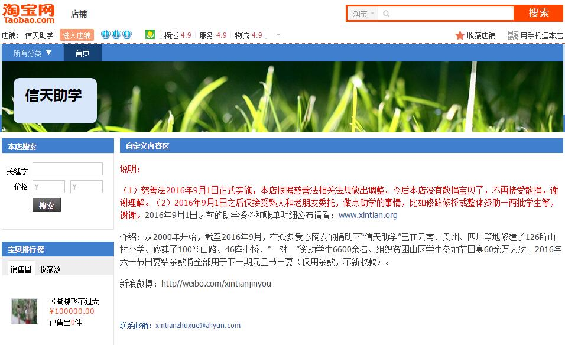

今天是个全民大剁手的日子，本来疯狂买买买是件挺开心的事，我也不例外，凌晨就剁了不少，但是有些热门商品还是抢不过神通广大的网友啊。下午收拾好博客后，本想再找找收藏夹买条皮带的，结果翻到了信天谨游的淘宝店，想着好久都没关注了，就点进去看了一眼，没想到就发现了这么个闹心的事：  我不记得是什么时候开始、从哪里得知才关注信天谨游的，只记得他从很早之前就开始帮贫困山区修建小学、架桥铺路，还有后来的助学一对一资助，以及那会我最关注的逢年过节请山里的孩子吃顿肉。之所以关注这个，一是因为那会我没什么钱，这个活动一块猪肉只要16块，我能捐的起。另一方面是那会大家对官方的慈善机构没有任何信任感，而信天谨游官网的内容让人信服，再加上一些我信任的人、信任的机构推荐，让我也不止一次的向身边的人推荐过。还有我知道小孩子对吃肉的渴望，我小时候也没肉吃，知道没肉吃的滋味。 反正自从得知这个活动后，我就试探性的买了两块，为此我专门盯了官网一阵子，等看到官网上传的款项明细统计、孩子吃肉的照片、捐助名单里我的淘宝ID后，我算彻底服了。因为我知道这不是个简单的事，我们可以在淘宝上随意点两下，只抬抬手付出了一点微不足道的金钱，慈善这件事对我们来说就算做完了。而对他们来说，从活动前期策划准备，到实施，以及后期的数据统计、上传，哪一项都不是动动嘴皮子、抬抬手就能办了的，这要不怕麻烦、不吝付出，这样的人咱从心眼里就佩服。尤其还要面对很多人的质疑，还有人要求退款，这都让我意识到慈善从来都不是个那么简单、纯粹的事。再看官网上也没有虚头八脑的东西，所有内容都是我们所关心的、想了解的，有关助学、认捐的事都非常仔细、慎重，这说明人家是用了心的。这么一个人不为利益、不为声名，不怕麻烦、不惧质疑的做慈善，应该算伟大了吧？ 后来基本每次看到活动举办我都会买两块，最多买过4块。直到前几年因为金额太小统计麻烦，猪肉直接改为了100元后觉得肉疼，才停止捐助。再后来长期不关注就慢慢淡忘了，但我绝对没想到今天会因为有新慈善法这么个东西，而让信天谨游停止接受散捐。我对新慈善法也没什么看法，既不清楚也不了解，反正这玩意咱们屁民向来都只有逆来顺受的份。但我就想问问这么把个人募捐一棒子全打死是不是因噎废食？以后捐款、募捐怎么搞？给红十字会吗？

<iframe frameborder="no" border="0" marginwidth="0" marginheight="0" width="330" height="86" src="http://music.163.com/outchain/player?type=2&amp;id=435948315&amp;auto=0&amp;height=66"></iframe>
