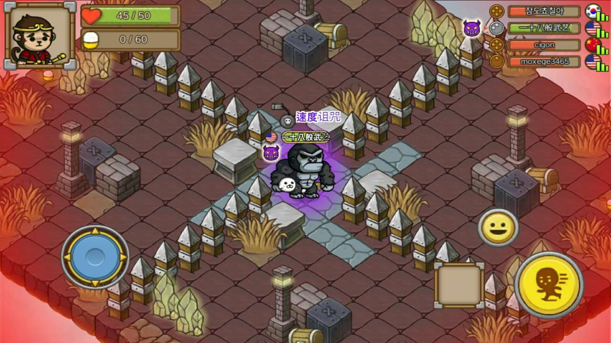
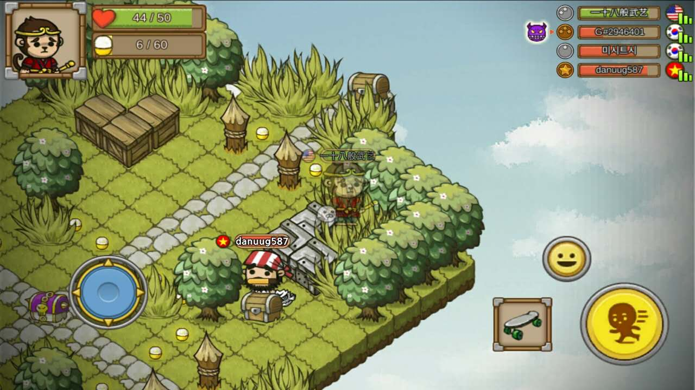
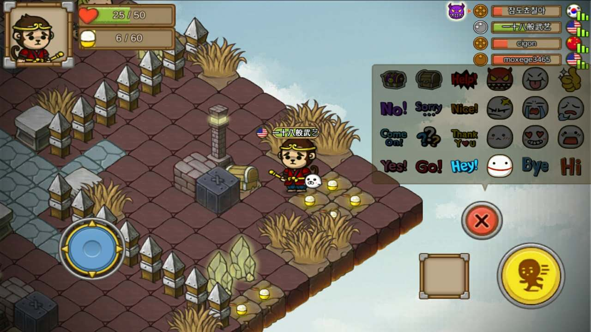
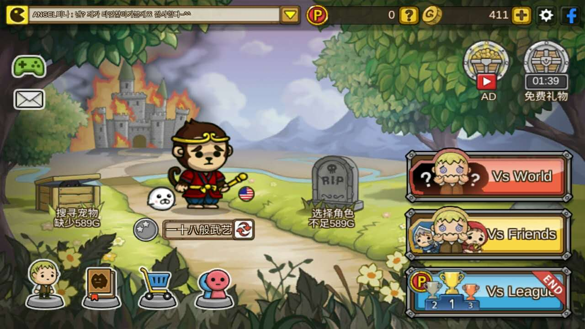

国庆上班，看着不少同事、朋友堵在高速上，心里一阵暗爽。尤其是一位朋友不顾劝阻，非要1号当天去湛江，结果就堵到第二天凌晨两点才下车，何苦呢？国庆期间上班多舒服，什么事也不用做，大家打游戏的打游戏，逛街的逛街，多和谐。再加上小领导貌似在JK COCO充值了1000块，果汁各种喝的爽歪。不过这些个饮料也暴利的，我看最贵的一小杯石榴汁要38，这都能买几斤石榴了？ 国庆最后几天休息在家看娃，闺女这最近吃的还不错，奶粉虽然没多吃，但是辅食吃的很开心。最近也在考虑给她多来几种新花样，前天媳妇还专门买了个辅食机，用了一次效果不理想，准备退掉重新换一台用。国庆期间上班其实也没闲着，一直在撸啊撸，但是下班看娃之余也不能闲着啊，这不最近发现了个手机小游戏还挺有意思，给大家介绍下。PS:主要是没的写拿游戏来凑数。 游戏名字叫：幽灵转轮，英文名：Spooky Runner。安卓的话Google Play跟酷市场都有下载，爱疯能不能玩不清楚。 游戏玩法很简单，有点类似猫抓老鼠+躲猫猫。进入游戏后4人分别选择卷轴，其中随机一人被诅咒后变成鬼，变鬼后会不断掉HP，所以就要抓其他3人传染诅咒，被抓到的替代他变成鬼。期间都可以躲在草丛隐身、开箱子获得随机诅咒or随机道具、拾取地上补充MP的道具用来加速。  游戏过程很欢乐，不仅可以同世界各地的玩家玩（看国旗大都是韩国人），还可以选择团队战，即4人分作两队来配合，或者拉几个朋友一块玩，乐趣多多。建议游戏开始时，大家选择好卷轴可以走动后，就立马逃到一个无人的角落，躲在前方有遮挡的草丛里隐身，最好附近还有个箱子可以拿道具，这样可以坐看他们拼个鱼死网破，即使被发现，也可以依靠箱子里的随机道具、周围的遮挡物来跟鬼兜圈子，毕竟鬼是在不断耗血的，一直耗下去对他来说没有好处。 另外游戏过程虽然无法打字沟通，但是可以选择发送表情，表情都挺逗的，可以在游戏中嘲讽敌人拉一下仇恨。但是表情是需要用游戏里面的G币购买，G币每次游戏结束后会获得几百、几十不等，也可以通过观看广告、免费礼物获得。 值得一提的是游戏里所有道具都可以通过G币购买，玩玩游戏、看看30秒的广告所获得的G币基本够用。G币可以用来抽取角色、宠物，宠物还有附加技能，并且技能可以通过G币升级。不过我现在所有的G币都用来抽取角色了，大概看了下，角色一共103个，宠物一共50个，每个1000G币。顺便说一句：我特么已经连续抽了7个女性角色了，男性抽到的全都不是人，看来我还有很长的路要走。 因为游戏中鬼是不断掉血的，即使4个人轮流做鬼，游戏时间也不会太长，遇到会玩的也是几分钟一局，对于我来说看娃之余来一局很合适。不过这游戏有一个缺点，就是需要翻墙联机，不过我觉得这对大家来说应该不算事了吧？ 今天来首Mr.Graceless翻唱的干杯朋友，不多说，好听：

<iframe src="http://music.163.com/outchain/player?type=2&amp;id=30070852&amp;auto=0&amp;height=66" width="330" height="86" frameborder="no" marginwidth="0" marginheight="0"></iframe>
