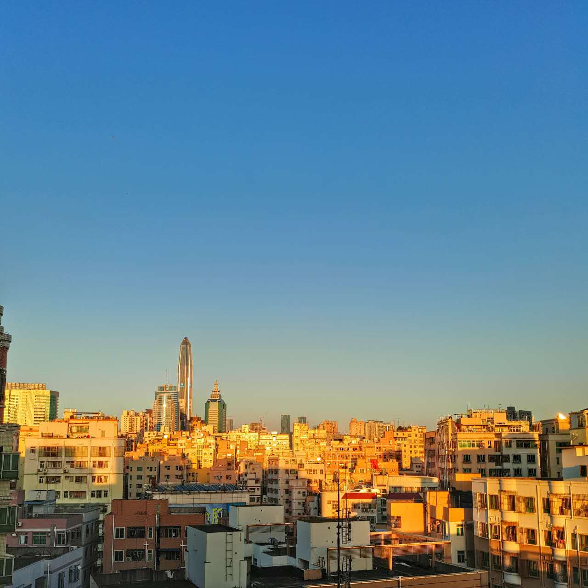

此事说来话长啊。 

<iframe src="http://music.163.com/outchain/player?type=2&amp;id=16361172&amp;auto=0&amp;height=66" width="330" height="86" frameborder="no" marginwidth="0" marginheight="0"></iframe>

年前就跟我妈喝茶的时候说想换个手机的，老人家觉得能省钱就省点钱吧，但我MX3已经服役两年了，这卡顿感人肺腑的，并且自从年前回家冻了几次之后，电量动不动就唰唰往下掉，实在受不鸟。网上看了一圈，想买个屏幕不大、有指纹、3G的RAM、外观好看价格又不贵的选择真心不多，最后还是又重新投入了大魅族的怀抱，忍了忍买了个pro5，俗称破5。听起来就跟刚过完年似的。 年前就用京东白条加上白条券不到3K入手。话说京东这配送也相当感人。由于经常买些油盐酱醋啥的，每次都是直接送到家里来，导致京东配送小伙已经认识我妈了，现在送货都不给我打电话了，直接送上门有木有，临走还很客气的跟我妈说走了啊，我妈也爱跟人答茬，还跟人客套你不坐会了啊？我当时听我妈跟我说都乐坏了，想着小伙不得来句为人民服务啥的？结果我妈说人家客气的说了句不坐了，就转身绝尘而去了。 手机到手还是flyme4.5，直接刷了稳定版flyme5.1，感觉确实比以前好用多了，流畅的不像flyme是真的。也不知道魅族怎么想起这句slogan的，自己打自己脸也是挺醉得。系统方面更像安卓原生靠近，终于去掉了个那个傻逼的smartbar，mback绝壁是目前安卓最好的交互模式，没有之一！再配合悬浮球，整个系统好用简洁流畅高效，魅族终于干了件靠谱的事。唯一的缺点就是屏幕对我来说大了点，还有就是成像质量一般，但是这年头大家各种滤镜往上套的，基本也就没差了。  废话扯了这么多，还是说说强迫症的事儿。买手机时随手机一块买了个贴膜，买的时候也没仔细看，手机由于京东黑色无货，只好选了白色，拿到手感觉还好，但是打开贴膜包装的时候就特么傻眼了，贴膜竟然是黑色的！想了想还是贴上了，正好把手机当黑色的用。但是贴的时候没仔细看，中间有水印，完了屏幕左侧上方有个小豁口，不知道是我自己碰的还是贴膜本来就这样。忍着看了两天看着屏幕中间的水印实在是不爽，想把贴膜揭了重新贴一下，结果不出我所料，贴膜从豁口的地方直接折了。这下终于是没水印了，特么直接多了一道裂痕。 默默的喝了口茶压压惊，当机立断给我媳妇打了个电话，给你买个贴膜吧，前两天你手机贴膜不正好摔了一道裂纹么，淘宝两张妥妥的。这次仔细看了下是不是白色的，确认无误，下单等货。由于淘的深圳本地商家，第二天就到货了，兴致勃勃打开、贴上一气呵成。怎么说呢哈，这2.5D玻璃屏幕边缘就不能宽点么，贴膜两侧不能完全贴合屏幕，两道白条妥妥的。 怎么办，有点内伤想吐血。 
