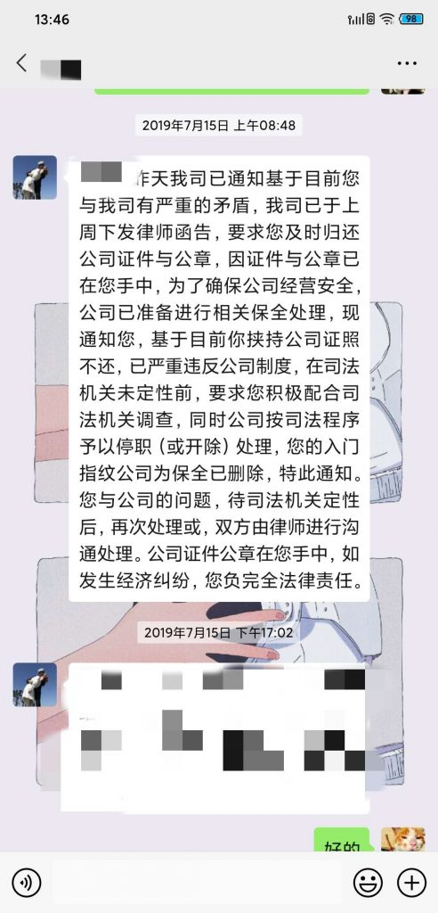

祸兮福之所倚，福兮祸之所伏 ，福祸之因果，让人难以琢磨。

女董事长借了两个多亿高利贷后，本想项目快速推进开盘回笼资金，预想着还掉贷款后应该还能赚一笔，结果项目半死不活一年多毫无进展。而集团公司也因为之前的各种业务、担保被银行抽贷，资金链断裂面临极大困难无力挽救，她又在孕傻之下做了最后一个死，违背董事长意志——拒绝高利贷利息归还，并且私下串通对方公司转让债权起诉我司。本来这事可以做的高明一点，但是在第一天董事长表达这个意思后，第二天对方公司就进行了债权转让，并且债权转让通知书上有我司公章！我看到这张通知书复印件的时候我都暗暗叫绝，这特么是什么神仙脑回路？人家债权转让通知你一声你盖什么章呢？后续第三天对方公司对我司进行诉讼，之后公司所有账户、资产被查封、董事长及一干高管账户、资产被查封、列为失信人员等等不赘述。

那这事跟我被辞有啥关系？因为这张债权转让通知书上的公章是女董事长从我手里拿去用的，那会公章正好在我手里保管，并且她用章这事我司只有三个人知道。董事长看到这张复印件肯定要追查这个公章是怎么盖上去的，并且这么大的事为啥资金负责人、财务负责人、董事长等一干高管全不知情，所以就来问我了。

董事长找我之前，她就电话不断，不断跟我说啥都不要说，一点事也没有。其实我心里很明白，但是也没法多说什么。见董事长前我先跟另外一知情高管聊了一下，他明确表示这是人家家事，不管我做什么决定，他都绝对为我保密。其实也很正常，任何人的任何决定都取决于他所处位置、立场，在情况不明的情况下，我谁也不能得罪。董事长是个很通情达理的人，他心里也很明白，见到我先问我这章是不是我保管、怎样保管，这个时间段内都有谁用章。然后拿出这张复印件问我章是不是假的，对这个有没有印象，并一再表示，这事跟我没有任何关系，但是这事很严重。我跟董事长回复印章保管情况后表示具体用章需要回去查询记录，章的真伪我不是专业人员无法回复。董事长表示理解，并对我说辛苦你晚上了又跑一趟，咱们第二天早上接着谈。

回头去见女董事长，很明显她慌了，从眼神就能看出她的惊恐，复述一遍后她反复安慰我说没事，咬死别说谁也没办法，我心想你哄鬼呢，这事哪能这么轻易完。我表面答应，随后联系了家人、认识的律师，他们一致建议我实话实说，分析各种利弊心里有底后第二天见到董事长，还是没把话说死，结果董事长要求我写明用章经过并签字，这就麻烦了，毕竟落字为凭啊。我回头找女董事长要求她去跟董事长说明情况，结果她跟我说要么你辞职吧，我心里一句MMP，嘴上说就算我辞职这事董事长就不追究了吗？进门前她害怕我录音要求我把手机放远一点，她就不动动脑子想想我就会拿一部手机吗？？？

其实这事她如果说给钱，给到一定数我特么也就死咬着不松口了，毕竟那会我妈病重，每个月开销负担很大。但是她一直哄我，结果就是我没听她胡逼，反复谈了几次之后，她还是拿不出个主意，我只好跟董事长实话实说，董事长也表示理解，会为我保密，并且希望我不要跟其他人再透露此事，我当然同意。这事表明上就算过去了。

后面过了一个多月她秋后算账逼我离职，并且以我劳动合同不在任职公司为由拒绝支付工资、补偿，期间还有她招来的人力行政总监从中作梗，在我、关联公司负责人之间信口雌黄、满口胡言，对三方人说三种话，没有一句实话。我与关联公司相关负责人都认识，并且一致表示对这种人真心佩服，她是怎么能做到这么厚脸皮的？所有人都在同一楼层办公并且认识时间都比她要长，怎么能做到跟A说假话跟B也说假话，AB都是死人不会沟通的吗？也不动动脑子想想，我敢拒绝她各种无理要求、不怕她各种威胁的原因是啥？我就没底牌吗？实际上那一个月我早就把自己经手的所有关键资料复印保存、整理好几个公司关联并且我有实际工作证明的文件，我早就做了最坏的打算，真到了仲裁或者诉讼，我一点都不怂。最后不出意外的跟她谈崩，我跟之前为我保密的高管透露此事：决定走仲裁、甚至诉讼。他听后让我别着急，先想办法安排我跟董事长见个面，在他的安排下我跟董事长聊了一下，董事长表示下周把所有人拉过来一定给我解决问题。本来这事可能也就这么完了，董事长人还是信得过的，有责任有担当，为人也正直，我的目的是拿钱，只要董事长出面这些问题肯定能解决，其他的也就算了。结果周末这个傻逼总监作死，微信通知我已经把我公司门禁指纹删除，并威胁我要以拒不交接公司证照起诉我。我冷笑一声，一直没怼你你觉得我好欺负是吧？周一有你好看的。

