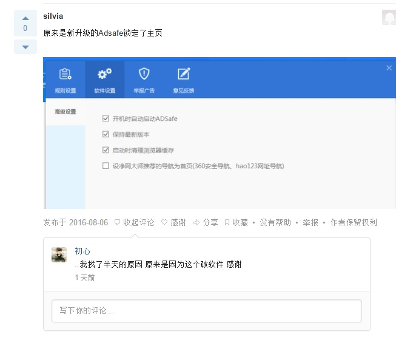

前天把公司电脑升级到了最新的14393，本来感觉还不错的，准备休息的时候把家里电脑也升级下。结果呢？今天一来公司就发现浏览器被篡改了！ 你想想，中午刚吃饱喝足，坐着公交唱着歌来到公司，打开IE却一眼看到了hao123，这事你能忍？但紧接着发现不仅IE，连Chrome也沦陷了，这绝对忍不了了！按照惯例先看了下IE、Chrome的设置，没问题。右键属性也看一眼，还没问题。打开注册表捋了一遍，又没问题？这就邪门了啊，平时我还挺注意网络安全的，既不会访问什么乱七八糟的网站，下载软件也大都是去官网下载，更何况最近也没安装什么破解软件之类的东西，怎么会突然就被篡改了呢？ [之前提到过我电脑有装QQ管家](http://mraaaa.com/1244)，但是因为最近它老是在更新后清除个人设置、瞎弹窗，被我一怒之下卸载了。本来如果没卸载的话还能用它锁定浏览器主页试试，但是既然卸载了就坚决不装了。想了又想，为了保险起见还是打开Windows Defender扫描了下，竟然也没什么问题。 排除设置问题、注册表、中毒这几个地方，只能看google怎么说了。google一下发现[知乎有个老帖](https://www.zhihu.com/question/21883209)有类似情况，虽然是老帖了，但也能参考一下啊。仔细看了一下，果然跟排名第一的回答情况一致，都是被篡改了Command line，这真是隐藏的太深了啊。但是按照帖子介绍使用ollydbg查看所依赖的dll文件时，问题又来了：ollydbg提示文件不是32位的，不能查看异常dll也就没法判断是什么软件在篡改，怎么办？还好接着看到楼下有用火绒剑钩子扫描的，接着下载安装火绒，顺便再吐槽一句，几年不见火绒，但这界面还是一样的丑啊。丑归丑，好用就行，钩子扫描完后仔细看了一遍，竟然没有异常dll？这就让人一脸懵逼了啊。 接着继续翻google，又看到说使用小马激活被篡改的，想着都激活那么久了，即使当时下载的文件是被动过手脚的，那也不至于让我用了这么久才篡改吧？但是还是尝试着删掉了OEM文件夹，重启过后竟然问题解决了！真是气得我一口老血。但这事还没完，用了没多久，打开IE后hao123它又出现了！ 这真是要逼死人啊！事情到了这个地步，不是它死就是它死。当我已经准备好重装系统时，想了想还是不甘心，默默打开Chrome输入了360，尝试使用流氓对付流氓，结果还是没用。流氓都干不翻啊？真让人绝望了。还好在这种紧要关头我杀意已决、贼心不死继续翻google，最后终于在知乎那个问题最下面翻到了答案：  这种比日了狗还恶心的心情你们能理解吗？ 
